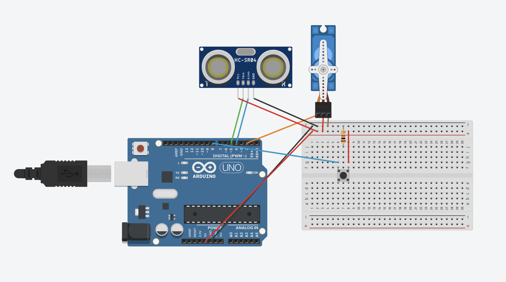

# Arduino Radar

An ultrasonic radar. A servo sweeps an HC-SR04 distance sensor from 15° to 165°, and the Arduino sends each angle and distance over serial. A Processing sketch draws the readings as a radar display.

## How it works

- The servo is on pin 2. The sensor's trigger is on pin 5 and echo on pin 4. A push button on pin 8 starts a sweep.
- When the button is pressed, the servo steps through the angles. At each step the sensor's distance is measured and sent as `angle,distance.`.
- The Processing sketch in `Processing_Code/` reads these lines and plots each reading on screen.

## Skills demonstrated

- **Embedded C++:** servo control, digital inputs and outputs, and timing.
- **Sensor interfacing:** timing an ultrasonic pulse to calculate distance.
- **Serial protocol design:** a simple text format that a second program can parse.
- **Data visualisation:** a live radar display in Processing.

## Run it

1. Wire the parts as in `Wiring_Diagram.png`.
2. Open `Arduino_Radar.ino` in the Arduino IDE and upload it.
3. Open the sketch in `Processing_Code/` in Processing, set the serial port, and run it.
4. Press the button to start a sweep.

## Notes

- The sweep uses `delay()`, so the Arduino does nothing else while it runs. A non-blocking timer would allow other tasks during a sweep.
